# Booking Flows — the whole package on one page

**Purpose.** This is the overview of everything `laravel-mollie-billing` does with money:
every path on which a subscription starts, renews, changes, fails, is refunded or ends —
who triggers it, which classes carry it, when Mollie is called, what is booked (invoice,
credit note, wallet), which events and mails go out, and what happens when a step fails.
The other documents in `docs/` explain single topics in depth; this one shows how they
connect.

**How to read it.** Start with the [state map](#0-state-map). Every other section is one
flow with one diagram. In the diagrams:

- a box names a real class from `src/` (or a `subscription_meta` key, in lower case);
- **Mollie** boxes and arrows name the request class from the Mollie SDK that is sent;
- every Mollie request goes through `MollieCall`, which refuses to send while a database
  transaction is open — so wherever a diagram shows a Mollie call, nothing is held;
- "customer mail" means the billable's own recipients (`MollieBilling::notifyBillingAdmins()`),
  "operator mail" means the system admins (`MollieBilling::notifyAdmin()`).

**This file is part of every change to a flow.** A new service, handler, job or event, a
changed transition, a new coupon type, a changed order of Mollie call and booking: the
diagram concerned is updated in the same change. `tests/Feature/Coverage/FlowDiagramGuardTest.php`
enforces the part a machine can check — every service, handler, job, controller, event and
enum case of the package is named here, and every class named here exists. Whether a
diagram is *right* remains the author's job.

## Contents

0. [State map](#0-state-map)
1. [Checkout of a paid plan](#1-checkout-of-a-paid-plan)
2. [Checkout with a trial or a zero-amount mandate](#2-checkout-with-a-trial-or-a-zero-amount-mandate)
3. [Free plan, and the upgrade from Local to Mollie](#3-free-plan-and-the-upgrade-from-local-to-mollie)
4. [Coupons](#4-coupons)
5. [Access grant and plan waiver](#5-access-grant-and-plan-waiver)
6. [Renewal](#6-renewal) — [6.1 Moving the next charge: PATCH or replacement](#61-moving-the-next-charge-patch-or-replacement)
7. [Failed renewal and dunning](#7-failed-renewal-and-dunning)
8. [Plan and interval change](#8-plan-and-interval-change)
9. [Seats and addons](#9-seats-and-addons)
10. [Scheduled change](#10-scheduled-change)
11. [Usage and overage](#11-usage-and-overage)
12. [One-time orders](#12-one-time-orders)
13. [Refunds, and the refunds the package makes on its own](#13-refunds-and-the-refunds-the-package-makes-on-its-own)
14. [Activation retry](#14-activation-retry)
15. [Cancellation, resubscribe, expiry](#15-cancellation-resubscribe-expiry)
16. [Chargeback](#16-chargeback)
17. [Webhook intake](#17-webhook-intake)
18. [VAT and OSS](#18-vat-and-oss) — [18.1 Invoice document and e-invoice](#181-invoice-document-and-e-invoice)
19. [Scheduled jobs](#19-scheduled-jobs)
20. [Entry points and supporting classes](#20-entry-points-and-supporting-classes)

---

## 0. State map

A billable has a **status** (`SubscriptionStatus`) and a **source** (`SubscriptionSource`).

| Status | Value | Meaning |
|---|---|---|
| `SubscriptionStatus::New` | `new` | billable exists, no subscription yet |
| `SubscriptionStatus::Trial` | `trial` | trial running; access granted, nothing charged yet |
| `SubscriptionStatus::Active` | `active` | running subscription |
| `SubscriptionStatus::PastDue` | `past_due` | a renewal is unpaid, a chargeback came in, or an overage debt stands |
| `SubscriptionStatus::Cancelled` | `cancelled` | cancelled, access until `subscription_ends_at` |
| `SubscriptionStatus::Expired` | `expired` | ended; plan fields wiped |

| Source | Value | Meaning |
|---|---|---|
| `SubscriptionSource::None` | `none` | no subscription (New, Expired) — also a Trial an operator gave to a New billable (T14): no mandate, no Mollie subscription |
| `SubscriptionSource::Local` | `local` | free plan or access grant; no Mollie subscription, nothing is charged |
| `SubscriptionSource::Mollie` | `mollie` | Mollie subscription with a mandate; renewals arrive as webhooks |

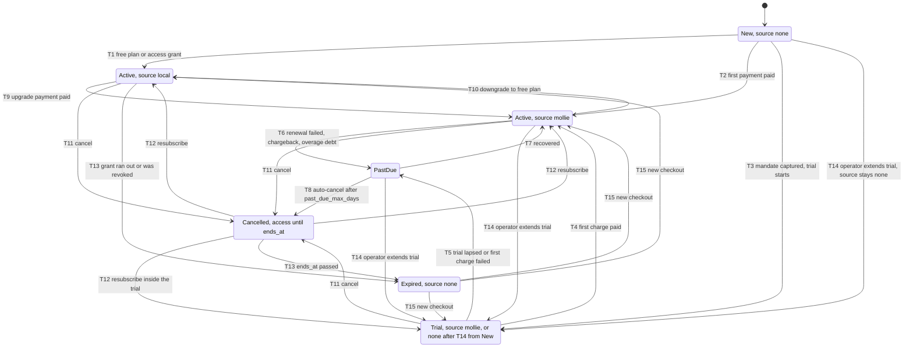

| # | Transition | Triggered by | Flow |
|---|---|---|---|
| T1 | New → Active (local) | `ActivateLocalSubscription` from `StartSubscriptionCheckout` (order costs nothing), or `CouponService` redeeming an `access_grant` | [3](#3-free-plan-and-the-upgrade-from-local-to-mollie), [5](#5-access-grant-and-plan-waiver) |
| T2 | New → Active (mollie) | `FirstPaymentHandler`, or `MandateOnlyPaymentHandler` for a fully covered first period; both through `CreateSubscription` | [1](#1-checkout-of-a-paid-plan), [2](#2-checkout-with-a-trial-or-a-zero-amount-mandate) |
| T3 | New → Trial | `MandateOnlyPaymentHandler` with `pending_subscription_trial_days` | [2](#2-checkout-with-a-trial-or-a-zero-amount-mandate) |
| T4 | Trial → Active | `SubscriptionPaymentHandler` on Mollie's first recurring charge; `ProrataChargeHandler` when a plan or interval change ends the trial | [6](#6-renewal), [8](#8-plan-and-interval-change) |
| T5 | Trial → PastDue | `ProcessTrialLifecycleJob` (no mandate, or no charge within 14 days of the trial end); `SubscriptionPaymentHandler` when the first charge fails | [7](#7-failed-renewal-and-dunning) |
| T6 | Active → PastDue | `SubscriptionPaymentHandler` (renewal failed), `UndercollectionCharge` (its payment failed), `ChargebackHandler`, `ChargeUsageOverageDirectly` (a debt stands) | [7](#7-failed-renewal-and-dunning), [11](#11-usage-and-overage), [16](#16-chargeback) |
| T7 | PastDue → Active | `SubscriptionPaymentHandler` (renewal paid), `ProrataChargeHandler` (past-due reset), `ChargebackHandler` (reversal), `SingleChargeHandler` / `ChargeUsageOverageDirectly` (debt paid or written off). All ask `ChargeUsageOverageDirectly::statusAfterRecovery()` | [7](#7-failed-renewal-and-dunning), [11](#11-usage-and-overage) |
| T8 | PastDue → Cancelled | `PrepareUsageOverageJob` pass 4 through `CancelSubscription` | [7](#7-failed-renewal-and-dunning) |
| T9 | Active local → Active mollie | `LocalToMollieUpgradeHandler` | [3](#3-free-plan-and-the-upgrade-from-local-to-mollie) |
| T10 | Active mollie → Active local | `UpdateSubscription` when the target bills nothing | [8](#8-plan-and-interval-change) |
| T11 | → Cancelled | `CancelSubscription` (portal, admin), `CountryMatchService` (mismatch flagged), `PlanWaiver` end with `grant_on_expiry = end` | [15](#15-cancellation-resubscribe-expiry), [18](#18-vat-and-oss), [5](#5-access-grant-and-plan-waiver) |
| T12 | Cancelled → Active / Trial | `ResubscribeSubscription` | [15](#15-cancellation-resubscribe-expiry) |
| T13 | → Expired | `PrepareUsageOverageJob` pass 1; `CouponService::revokeGrant()` | [15](#15-cancellation-resubscribe-expiry), [5](#5-access-grant-and-plan-waiver) |
| T14 | → Trial | `HasBilling::extendBillingTrialUntil()` (admin panel, `trial_extension` coupon) — allowed from New, Trial, Active, PastDue | [4](#4-coupons) |
| T15 | Expired / Cancelled / PastDue without a live subscription → new subscription | a new checkout; `MandateOnlyPaymentHandler` and `FirstPaymentHandler` activate whenever no accessible subscription exists | [1](#1-checkout-of-a-paid-plan) |

Every transition dispatches an event (listed per flow); `RecordBillingAudit` writes each of
them to the audit trail.

---

## 1. Checkout of a paid plan

**Trigger:** portal checkout page (`BillingPortalController::checkout()` → Livewire
checkout) → `StartSubscriptionCheckout`. **Webhook:** `FirstPaymentHandler`.

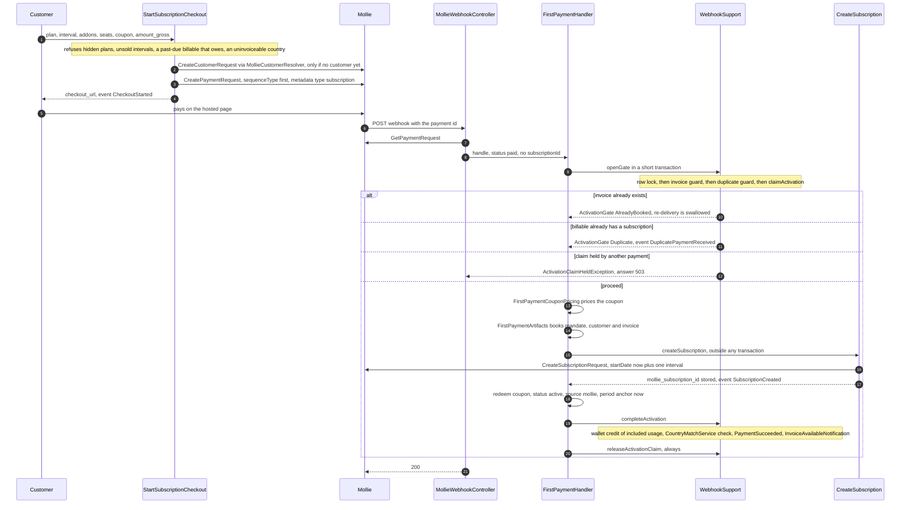

- **Booked:** one invoice for the first period (`InvoiceService::createForPayment()`, serial
  from `InvoiceNumberGenerator`); wallets credited with the included usage
  (`WalletUsageService`, event `WalletCredited`); a `CouponRedemption` if a code was priced
  (event `CouponRedeemed`).
- **Events:** `CheckoutStarted`, `InvoiceCreated`, `SubscriptionCreated`, `PaymentSucceeded`;
  `PaymentAmountMismatch` when the paid gross differs from what the lines cost.
- **Mail:** `InvoiceAvailableNotification` to the customer.
- **Two phases, on purpose.** `openGate()` is a short transaction; the Mollie call runs after
  it with only the claim (`subscription_meta.activation_claim`,
  `WebhookSupport::ACTIVATION_CLAIM_TTL_MINUTES`) held. A *different* payment arriving in
  between gets `ActivationClaimHeldException` → 503 → Mollie re-delivers.
- **Failure:** `CreateSubscriptionRequest` throws → the invoice stays, the billable is *not*
  activated, `SubscriptionActivationFailed` is dispatched and the activation is retried —
  see [14](#14-activation-retry). A `trial_extension` code on a paid first payment is not
  redeemed. If `CouponService::redeem()` fails after the discount was granted,
  `CouponRedemptionRecordMissing` is dispatched and the operators are told.
- **Abandoned:** a `failed` / `canceled` / `expired` first payment never makes a billable
  past due; `CleanupOrphanedBillablesJob` removes a billable that never got further and
  dispatches `CheckoutAbandoned`.
- **Draft before the submit.** The checkout keeps what was typed and picked as a draft in
  the session (`CheckoutDraft`, `checkout_draft_ttl_minutes`), filed per signed-in user,
  billable and checkout URL. A reload or a later visit restores it and re-runs the step
  validators in order (VIES included) to resume at the furthest step that holds; the coupon
  is re-validated by code. Nothing is written to the billable for it, and no amount, VIES
  verdict or billable id is ever taken from it. It survives a payment left at Mollie (a
  signup's draft follows the billable it created, `CheckoutDraft::adoptCreated()`), and is
  dropped by `CheckoutDraft::forgetFor()` once the subscription exists — the return page,
  a booking that completes without Mollie, or the checkout redirecting an active billable —
  and when the billable is gone or the visitor may no longer act for it.
- **Return page.** It decides on load: the subscription has landed (activated), something
  is under way (`pending_first_payment_id`, `activation_claim`, `activation_retries`,
  `upgrade_from_local_origin` — it polls and asks Mollie about the pending payment), or
  nothing is: "no subscription has been taken out yet" with the way back into the
  checkout, and no polling. A failed / cancelled / expired payment is reported once and
  clears the marker, so a later visit lands in the last state. A first payment still
  `open` after ~10 s of polling counts as **abandoned** — "previous page" at Mollie lands on
  the redirect URL, not the cancel URL, and leaves the payment `open` — and the page says
  so and leads back into the checkout; the marker stays.
- **A second submit with a first payment on record** (`reusablePendingCheckoutUrl()`):
  `open` with a checkout link → back to that link, no second payment; `pending` → the
  return page; `open` *without* a checkout link (Mollie drops it once the customer has
  picked a method and gone back) or any terminal status → a new payment.
- **The confirm button names the path** `StartSubscriptionCheckout::handle()` will take
  (`checkout::bookingPath()`): pay now, start the trial and add a payment method, add a
  payment method under a fully covering code, activate a free plan, or activate an access
  grant. A trial is announced only on the trial path.

---

## 2. Checkout with a trial or a zero-amount mandate

**Trigger:** the same checkout. `StartSubscriptionCheckout` hands over to
`StartMandateCheckout` when a trial starts (plan interval has `trial_days`, no mandate yet,
the order costs something) or when coupons bring the first charge to zero.
**Webhook:** `MandateOnlyPaymentHandler` (metadata `type = mandate_only`).

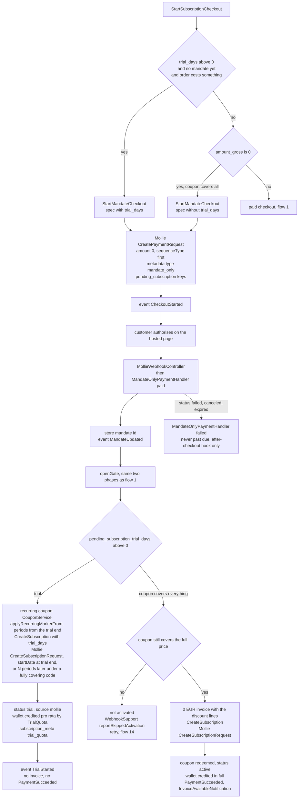

- **Trial:** nothing is charged and no invoice is written. Mollie's subscription starts at
  the trial end with the full amount; that first charge is a renewal ([6](#6-renewal)) and
  turns `trial` into `active` (`TrialConverted`, `TrialConvertedNotification`).
- **Coupons on a trial:** `recurring` → marker written before the subscription is created,
  so Mollie's amount is already discounted; a redemption with discount 0 occupies the
  campaign slot. `single_payment` → the same, as a marker of exactly one period
  (`CouponService::applyFirstChargeMarkerFrom()`, `first_charge_only`): the charge at the
  trial's end is the discounted one, and that renewal PATCHes Mollie back to the full
  amount; at 100 % Mollie starts one period after the trial end. (A code parked in
  `pending_first_charge_coupon` by an earlier release is still honoured by the first charge
  if the amount Mollie collected reflects it.)
  `trial_extension` → redeemed here, once the Mollie subscription exists.
- **Trial end is watched** by `ProcessTrialLifecycleJob`: `TrialEndingSoonNotification`
  ahead of the end; a trial without a mandate, or one whose first charge has not arrived
  14 days after the end, becomes `past_due` (`TrialExpired`, `TrialExpiredNotification`).
  A trial whose first charge a discount defers past its end (a fully covering code, free
  plan periods) becomes `active` at the first run after the end: the period starts at the
  trial end and runs on its day (`billing_anchor`), the trial quota is replaced by the full
  period quota, `TrialConverted` is dispatched (the conversion mail waits for the first
  charge's invoice). The free periods then turn over like any deferred subscription's
  (`PrepareUsageOverageJob`, case A0).
- **The same payment type changes a payment method.** `StartMandateCheckout` without a
  subscription spec only captures a new mandate: `MandateUpdated` →
  `RevokePreviousMandate` → `RevokeMollieMandateJob` (Mollie `RevokeMandateRequest`; 404 and
  410 count as done). `MollieMandateInspector` (`GetMandateRequest`) reads the mandate for
  the billing-data page.
- **A trial whose local end passed while Mollie's first charge is still scheduled:**
  `MollieSubscriptionGate` (`GetSubscriptionRequest`) sends the customer to the dashboard
  instead of a second checkout; "Charge now" PATCHes the start date to today
  (`UpdateSubscriptionRequest`). A reference Mollie no longer knows is removed
  (`MollieSubscriptionReferenceCleared`).

---

## 3. Free plan, and the upgrade from Local to Mollie

**Trigger:** checkout of a plan whose order nets to zero → `ActivateLocalSubscription`
(no Mollie call at all). Later, plan page → `UpgradeLocalToMollie`.
**Webhook:** `LocalToMollieUpgradeHandler` (metadata `upgrade_from_local = true`).

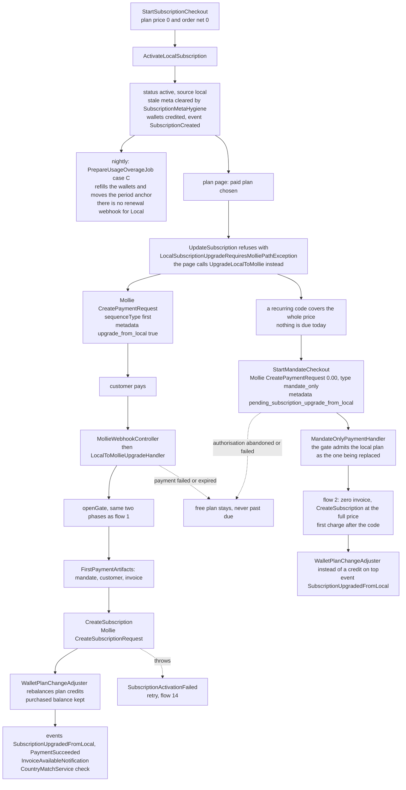

- A Local subscription cannot buy paid extras through `UpdateSubscription`
  (`LocalSubscriptionDoesNotSupportPaidExtrasException`) or products
  (`LocalSubscriptionCannotPurchaseProductsException`). The exception is a *gifted* plan —
  see [5](#5-access-grant-and-plan-waiver).
- An upgrade a recurring code covers in full has nothing to collect, but a paid plan needs
  a mandate: `UpgradeLocalToMollie` hands it to `StartMandateCheckout`, and from there it
  is flow [2](#2-checkout-with-a-trial-or-a-zero-amount-mandate) — the checkout's own
  activation, with the same invoice and the same deferred first charge. A customer who
  already has a mandate is asked for the €0 authorisation as well. The plan screen
  announces it: nothing today, the first charge on a named day.
- While that payment (or a paid upgrade's) is pending, the return page asks Mollie about
  it instead of taking the free plan the customer already has for the result.
- The way back, Mollie → free plan, is a plan change ([8](#8-plan-and-interval-change)).

---

## 4. Coupons

`CouponService` is the only entry point: `validate()` → `redeem()` (row lock on the coupon,
`redemptions_count` incremented, `CouponRedemption` written, event `CouponRedeemed`). Each
screen passes the types it accepts; anything else is refused with
`type_not_allowed_in_context`.

| `CouponType` | Value | Checkout | Dashboard code field | Plan page | Seats | Addons | Products |
|---|---|---|---|---|---|---|---|
| `CouponType::SinglePayment` | `single_payment` | yes | explains only | no | no | no | yes |
| `CouponType::Recurring` | `recurring` | yes | yes | yes | yes | yes | no |
| `CouponType::Credits` | `credits` | no | yes | no | no | no | no |
| `CouponType::TrialExtension` | `trial_extension` | yes, if a trial starts | yes, during a trial | no | no | no | no |
| `CouponType::AccessGrant` | `access_grant` | yes | yes | no | no | no | no |
| `CouponType::PeriodExtension` | `period_extension` | no | yes | no | no | no | no |
| `CouponType::PlanWaiver` | `plan_waiver` | no | yes, and admin | no | no | no | no |

The dashboard field is `RedeemCouponFromPortal`, which recognises the type and answers
with a `PortalCouponOutcome`. An auto-apply link goes through `PromotionController`, which
parks the code in the session and redirects to checkout.

Common gates for every type: active, `valid_from` / `valid_until`, `max_redemptions`,
`max_redemptions_per_billable`, plan / interval / addon / product filters, minimum order,
stackability (`CouponNotStackableException`), at most one `recurring` per apply set.

### 4.1 `single_payment`

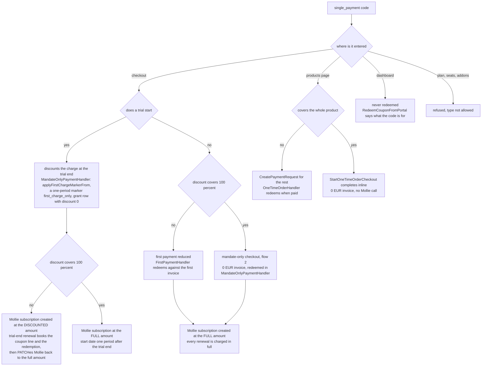

### 4.2 `recurring`

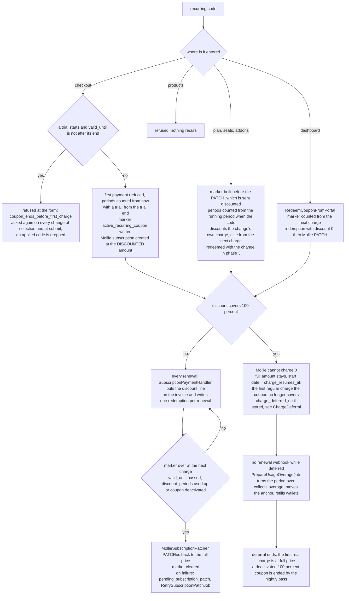

- Lifetime is fixed when the marker is written: the earlier of the coupon's `valid_until`
  and the day before `from + discount_periods` **billing periods** — calendar months or
  years on the subscription's billing day (`Support\BillingAnchor`, 31 Jan → 28 Feb →
  31 Mar), not 30-day blocks. `from` is the start of the first discounted period: the
  checkout or upgrade (now), the trial end, the next charge (dashboard, or a change whose
  own charge the code does not discount) or the running period (a change whose charge it
  does). The count of discounted charges is enforced as well.
- Under a fully covering code the marker carries `charge_resumes_at`, the first regular
  charge its window no longer covers — `from + N` periods, or for a code with a fixed end
  date the first regular charge on or after that day. `CreateSubscription` and
  `MollieSubscriptionPatcher` send it as Mollie's start date; the portal's next charge and
  `charge_deferred_until` are the same date. A marker written before 17 November 2026 has
  no `charge_resumes_at` and keeps `valid_until + 1 day`.
- The confirm step of the checkout names that first charge (`checkout.full_coverage_redirect_notice`,
  after a trial `checkout.trial_redirect_notice`), the plan screen too
  (`portal.upgrade_first_charge`). On the day of a deferred charge, until Mollie's charge
  has arrived, the portal names that day (`ChargeDeferral::pending()` in `NextChargeSummary`).
- The discount base is locked (`base_amount_net`): seats and addons added later are not
  discounted.
- A marker and a plan waiver share one slot — a second one is refused with
  `recurring_conflict`.

### 4.3 `credits`

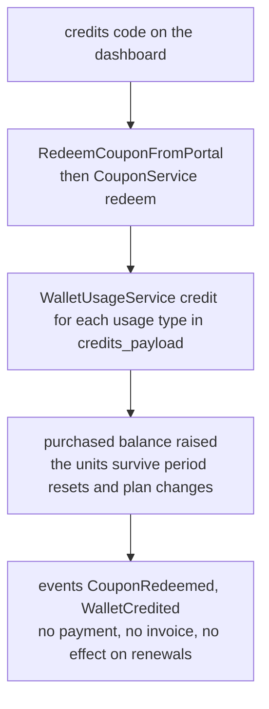

### 4.4 `trial_extension`

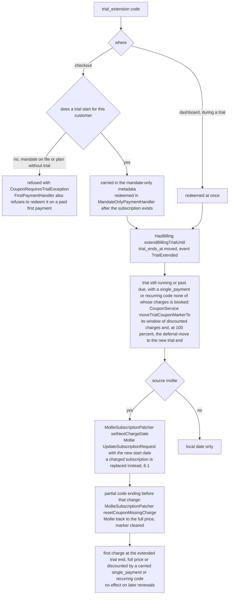

### 4.5 `access_grant`

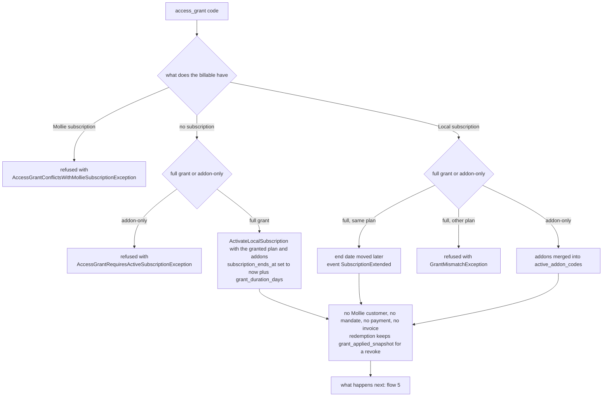

### 4.6 `period_extension`

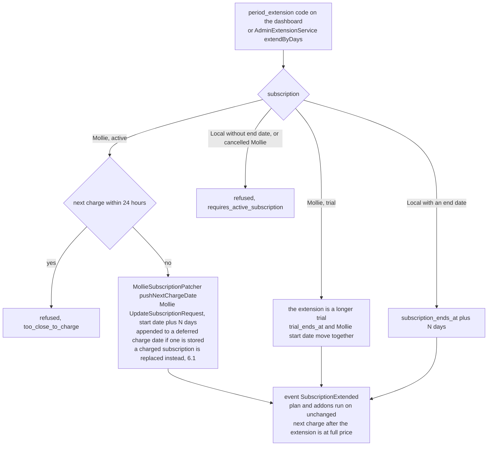

On an active Mollie subscription a `period_extension` is also refused with
`recurring_conflict` while a `recurring` coupon (not a waiver) is running.

### 4.7 `plan_waiver`

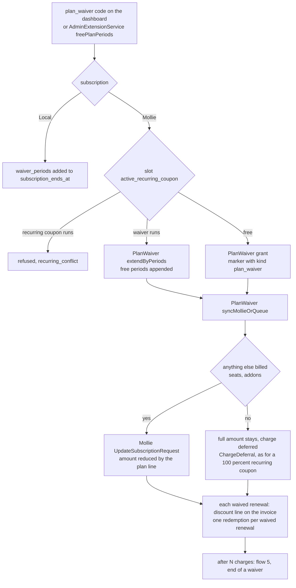

Counted in charges from the next one (during a trial: from the trial end), not in days, on
the subscription's billing day (`BillingAnchor` — from a next charge on 28 February of a
cycle on the 31st, two periods end on 30 April).
Deactivating the coupon does not end a running waiver; a revoke does (`GrantRevoked`,
`PlanWaiver::remove()`). An interval change is refused while a waiver runs.

---

## 5. Access grant and plan waiver

**Trigger:** an `access_grant` code (checkout, dashboard) or the admin panel's "issue grant"
screen; afterwards the addons and seats pages (`StartGrantExtrasPurchase`), the admin
subscription tab (`AdminExtensionService`), and the nightly pass.

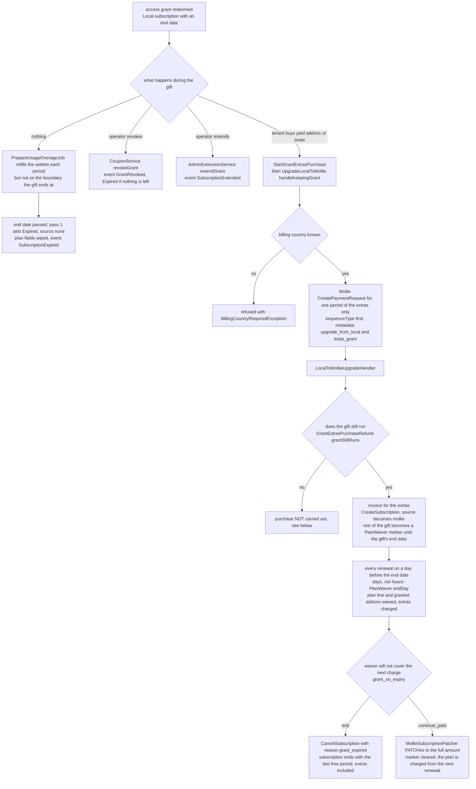

**The gift is gone when the payment for the extras arrives** (SEPA settles days later):
`GrantExtrasPurchaseRefund` books the payment as an invoice, returns it in full as its
credit note (`InvoiceService::createRefund()` → Mollie `CreatePaymentRefundRequest`),
creates no subscription and no waiver, revokes the captured mandate
(`RevokeMollieMandateJob`), dispatches `GrantExtrasPurchaseRefunded` and mails
`GrantExtrasPurchaseRefundedNotification` — each once per payment. A refund Mollie does not
accept is parked under `pending_refund_retries` for `RetryRefundLineJob`.

**Admin without a code** (`AdminExtensionService`, each leaves a one-off coupon and a
redemption as the audit trail): `extendByDays()` = a `period_extension`,
`freePlanPeriods()` = a `plan_waiver`, `extendGrant()` = the gift's end moves later, also
after it became a waiver; `PlanWaiver::setOnExpiry()` switches between `end` and
`continue_paid`. The identical action twice within `REPEAT_GUARD_SECONDS` (a double click,
a second tab) is refused: the claim is written to `subscription_meta.admin_extension_guard`
under the row lock before the action runs, so it holds across processes whatever the cache
store; a refused or failed action removes it at once. Once a gift has ended there is
nothing for `extendGrant()` to extend — free time is then given anew with
`freePlanPeriods()` or `extendByDays()`.

---

## 6. Renewal

**Trigger:** Mollie creates the recurring payment and calls the webhook; the payment
carries a `subscriptionId`. **Handler:** `SubscriptionPaymentHandler::paid()`. No Mollie
call is made to *collect* a renewal — Mollie does that on its own.

```mermaid
flowchart TD
    A["webhook: paid payment with subscriptionId"] --> B{"invoice for this payment exists"}
    B -->|"yes"| Z["re-delivery, nothing to do"]
    B -->|"no"| C["ScheduleSubscriptionChange applyAtRenewal<br/>a change due at this boundary that Mollie was told about is applied first"]
    C --> D["expected net from the LIVE configuration, SubscriptionAmount<br/>minus CouponService computeMarkerDiscount<br/>VAT from VatCalculationService"]
    D --> E["WebhookSupport reconcileWithPaidAmount<br/>difference becomes an adjustment line, event PaymentAmountMismatch"]
    E --> F["InvoiceService createForPayment<br/>period = payment createdAt to plus one interval,<br/>on the anchor day, BillingAnchor forCycle"]
    F --> G{"status active, trial or past_due"}
    G -->|"no, cancelled or expired"| H["WebhookSupport reportRenewalForEndedSubscription<br/>event RenewalCollectedForEndedSubscription<br/>Mollie CancelSubscriptionRequest<br/>UnwantedPaymentRefund, reason renewal_after_end"]
    G -->|"yes"| I{"payment was created for another configuration<br/>SupersededRenewalRefund settle"}
    I -->|"bought nothing: source no longer mollie,<br/>or the cadence has changed"| J0["whole payment refunded through RefundInvoiceService<br/>NOT booked as a new period, handler stops"]
    I -->|"collected too much"| J["surplus refunded through RefundInvoiceService"]
    I -->|"collected too little"| K["UndercollectionCharge settle<br/>event RenewalUndercollected"]
    I -->|"matches"| L["coupon bookkeeping"]
    J --> L
    K --> L
    L --> M["redeemRecurringCouponForRenewal: one redemption per discounted renewal<br/>parked first-charge coupon consumed<br/>spent charge_deferred_until forgotten"]
    M --> N{"marker over at the NEXT charge"}
    N -->|"waiver with on_expiry end"| O["CancelSubscription, reason grant_expired"]
    N -->|"coupon or waiver over"| P["MollieSubscriptionPatcher PATCH to full price<br/>updateRecurringAmountAfterCharge: the amount, no start date<br/>failure: pending_subscription_patch"]
    N -->|"still running"| C2
    O --> Q
    P --> C2
    C2{"period end on the anchor day is not<br/>simply one interval after this charge"}
    C2 -->|"yes, not deferred"| C3["MollieSubscriptionPatcher pinNextChargeDate<br/>Mollie GetSubscriptionRequest: is its own next date the anchor day<br/>no: the date is moved, 6.1, replacing the charged subscription<br/>failure: pending_subscription_patch, reason anchor_pin"]
    C2 -->|"no"| Q
    C3 --> Q
    Q["WebhookSupport collectOutstandingOverage<br/>ChargeUsageOverageDirectly, a Mollie payment of its own"] --> R["WebhookSupport creditPeriodQuota<br/>rollover types add, others reset and credit<br/>a debt still owed is preserved"]
    R --> S["period anchor moved with its anchor day, billing_anchor, seat_count from the invoice<br/>trial to active, past_due to active via statusAfterRecovery<br/>dunning keys cleared"]
    S --> T["events TrialConverted if it was a trial, PaymentSucceeded<br/>mails TrialConvertedNotification, InvoiceAvailableNotification"]
    T --> U["CountryMatchService check, last, after everything is booked"]
```

- **Booked:** one invoice per renewal; wallets refilled (`WalletReset`, `WalletCredited`);
  redemption rows for a running discount.
- **Undercollection** (`UndercollectionCharge`): a seat or addon booked after Mollie had
  already created the debit, or a plan change whose payment spanned the renewal. The case is
  claimed under the row lock, a recurring payment for the difference is created with a
  stable idempotency key (`CreatePaymentRequest`, metadata `type = prorata_charge`), the
  customer gets `UndercollectionChargedNotification`, the settlement is invoiced with one
  line naming the plan, or — for seats and addons — one line per component (`seats`, `addon`,
  `addon_seats`, each marked `undercollection`; `UndercollectionCharge::split()`), at the
  total and VAT of the single amount. `SupersededRenewalRefund` writes on the renewal's
  `adjustment` which lines it reduces (`reduces`), so a later credit comes out of the renewal
  line and its balance line in the same share. If the payment fails,
  `SubscriptionPaymentHandler::failed()` takes over — ordinary dunning; a plan or interval
  change from there is an ordinary change, not the reset ([7](#7-failed-renewal-and-dunning)).
  Operators are told only when no automatic way exists.
- **Renewal after the end:** booked, credited and refunded automatically
  ([13](#13-refunds-and-the-refunds-the-package-makes-on-its-own)); the lingering Mollie
  subscription is cancelled, or queued as `pending_subscription_cancel`.
- **The anchor day** (`BillingAnchor`, `SubscriptionPaymentHandler::pinNextChargeOnAnchor()`):
  a subscription keeps the day of the month it is charged on through the months that do not
  have it — 31 Jan → 28 Feb → 31 Mar → 30 Apr. `BillingAnchor::forCycle()` derives the day
  from the charge (a charge on a month's last day continues the previous period's longer
  day — or, for the first charge after a trial, the trial end's day), the renewal stores it as `subscription_meta.billing_anchor` beside the period start,
  and `nextBillingDate()` ends the period on it. Wherever that is not simply one interval
  after the charge, the renewal asks Mollie for its own next date and, where that is not the
  anchor day, moves it (`pinNextChargeDate`, [6.1](#61-moving-the-next-charge-patch-or-replacement)),
  so Mollie charges where the period ends whether it counts on from the charge ("drift") or
  from its start date ("clamp"). Under "clamp" that happens once at most — when the start date
  itself was a shortened day; under "drift" after every month shorter than the anchor day. Not for a deferred charge, not when the gift ends the subscription; a deferred
  period is turned over on the anchor day by `PrepareUsageOverageJob`, and the charge that
  ends a deferral — on that day too, since a coupon's free periods are billing periods —
  continues it. A plan, seat or addon change without an interval change
  keeps the running period and with it the day (a change on 28 February of a cycle on the
  31st still renews on 31 March); only a new period start — an interval change, an upgrade
  from Local, a checkout — sets a new day, the day it starts. A Local subscription keeps its
  day the same way: `PrepareUsageOverageJob` turns its period over on the anchor day and
  refills then.
- **Local subscriptions and deferred charges have no renewal webhook.** Their period is
  turned over by `PrepareUsageOverageJob` ([19](#19-scheduled-jobs)).

### 6.1 Moving the next charge: PATCH or replacement

**Trigger:** anything that has to move the date of the next charge of a running Mollie
subscription — the anchor day after a short month (`pinNextChargeDate`), a trial or period
extension (`setNextChargeDate`, `pushNextChargeDate`, `deferNextChargeDate`), and every
`updateRecurringAmount()` that carries a start date: a fully covering code given mid-subscription,
a plan waiver, the end of a deferral, an interval change and the past-due reset.
**Classes:** `MollieSubscriptionPatcher::sendUpdate()`, `MollieSubscriptionReplacer`.
Mollie refuses a new start date once it has charged a subscription (422 "The start date
cannot be changed when the subscription is already charged", measured 17 November 2026);
amount, interval, description and metadata are still taken.

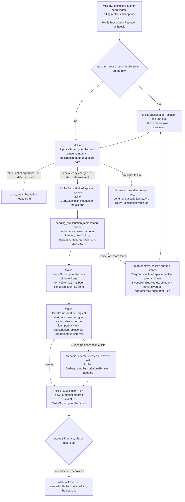

- **Cancel first, then create.** Mollie keeps a customer's subscription descriptions unique
  among the active ones, so creating first would need another description — and an
  interruption between the two would leave two subscriptions charging. Cancelled first, an
  interruption leaves none: nothing is collected until the successor exists, and the
  marker finishes it. Once the old one is cancelled at most one subscription with this
  description can exist, so a create whose answer was lost cannot be repeated into a second.
- **While a replacement is pending** `MollieSubscriptionGate` neither drops the cancelled id
  (no `MollieSubscriptionReferenceCleared`) nor lets a checkout start
  (`hasLiveMollieSubscription()` answers yes). A customer who cancels in between ends it: the
  retry drops the marker and creates nothing.
- **Payments of the old subscription** — a renewal that settles days later, its refund, a
  failure, a chargeback — still arrive and are booked as before: the webhook finds the
  billable through the payment's metadata ([17](#17-webhook-intake)), never through the
  subscription id. A cancel aimed at the old id later (`reportRenewalForEndedSubscription`)
  meets Mollie's 422 "has been cancelled", which counts as done.
- **`MollieSubscriptionGate::forceImmediateCharge()`** (the dashboard's "charge now" while a
  trial's first charge is still ahead) stays a plain PATCH to today: it is offered only for a
  subscription whose start date lies ahead, which Mollie has not charged; a refusal is shown
  as an error and replaces nothing.

---

## 7. Failed renewal and dunning

**Trigger:** webhook with status `failed` / `canceled` / `expired` for a payment that has a
`subscriptionId` → `SubscriptionPaymentHandler::failed()`.

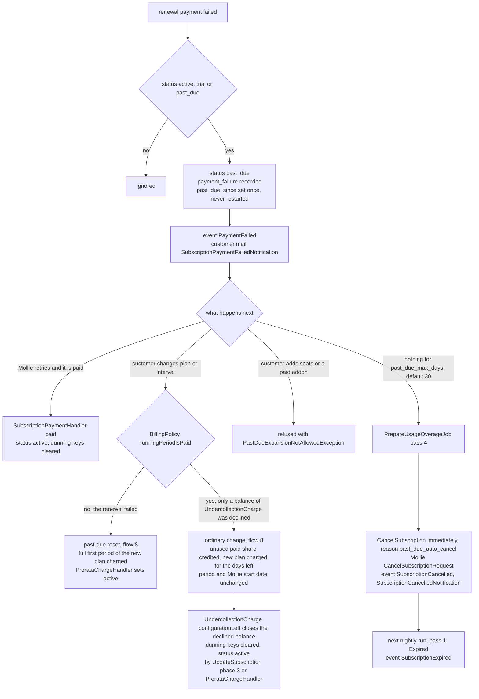

What is locked while past due, and what stays:

| | Renewal unpaid (`past_due_since`) | Overage debt only (`overage_past_due_since`) |
|---|---|---|
| Access to the product | stays | stays |
| Usage | only what the wallets hold; nothing may go below zero (`UsageLimitExceededException`) | the same |
| More seats, paid addons, products, a new checkout | refused | refused |
| Fewer seats, addon off, free addon | allowed | allowed |
| Plan or interval change | allowed — the past-due reset; an ordinary change when the period is paid and only a balance was declined | refused — the period is paid |
| Auto-cancel clock `past_due_max_days` | runs | does not run |
| Ends when | a renewal is paid, or a plan or interval change is made | the debt is paid or written off |

Both can hold at once; each ends only its own episode.

---

## 8. Plan and interval change

**Trigger:** plan page, `ChangePlan`, `HasBilling::changeBillingPlan()` →
`UpdateSubscription::update()`. Preview on the page comes from `PreviewService`.
**Webhook:** `ProrataChargeHandler` (metadata `type = prorata_charge`).

`plan_change_mode` (`PlanChangeMode`): `immediate` — only immediate changes;
`end_of_period` — a plan or interval change is scheduled ([10](#10-scheduled-change));
`user_choice` — the caller decides. Seat and addon changes are never governed by it.

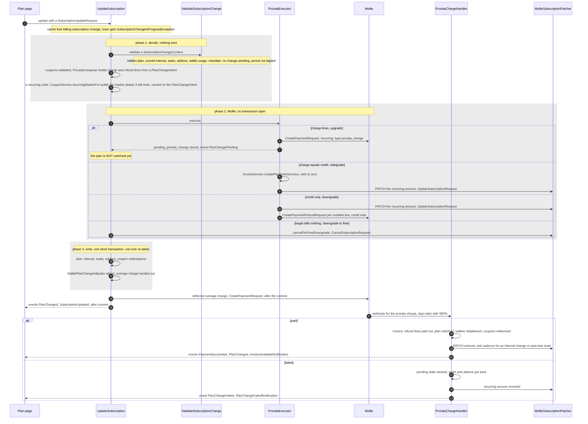

- **Three phases, one cache lock.** No Mollie call sits in a transaction; phase 3 re-reads
  `subscription_meta` because a job may have written to it in between.
- **Booked:** upgrade → prorata invoice when the charge clears; sidegrade → a plan-switch
  invoice that nets to zero; downgrade → a credit note per refunded line
  (`CreditNoteIssued`); wallets rebalanced, purchased units kept.
- **Downgrade to a free plan:** Mollie subscription cancelled, source becomes `local`,
  status normalised to `active`, coupon marker and dunning keys cleared.
- **Past-due reset:** a plan or interval change on a subscription with an unpaid renewal
  charges the full first period of the target and restarts the cycle.
- **During a trial:** a plan or interval change ends the trial and is charged; seats and
  addons inside the trial are free.
- **Failures and stragglers:**
  - PATCH fails → `pending_subscription_patch` → `RetrySubscriptionPatchJob` (dispatched at
    once and by `SweepPendingRetriesJob`); given up after 24 h with an operator mail.
  - An interval change or past-due reset moves Mollie's start date; on a charged subscription
    Mollie refuses that, and the subscription is replaced with the new amount, interval and
    start date ([6.1](#61-moving-the-next-charge-patch-or-replacement)).
  - Refund line refused → `pending_refund_retries` → `RetryRefundLineJob`.
  - The prorata webhook never arrives → `CleanupStalePendingProrataChangeJob` asks Mollie.
  - The customer cancels the pending change (`UpdateSubscription::cancelPendingPlanChange()`,
    Mollie `CancelPaymentRequest`); if the payment settles anyway it is returned by
    `UnwantedPaymentRefund` (`change_cancelled`), likewise when the subscription has ended in
    the meantime (`subscription_ended`).
  - The charge settles in the *next* period → `ProrataChargeHandler` recomposes the credit,
    then `UndercollectionCharge` or `SupersededRenewalRefund::refundOverpaid()` settles the
    period the change landed in.
- The legacy mid-cycle payment types `prorata`, `addon`, `seats` are still accepted by
  `SingleChargeHandler` (`UpdateSubscription::applyPendingPlanChange()`).
- **A second change in a period whose plan change settled after the renewal** is settled
  as if the period had been paid on the plan in between from its first day:
  `ProrataComposer::planRefundLines()` credits the renewal's plan line (and the balance line
  of `UndercollectionCharge`, which names the plan and carries `undercollection`).
  A balance still open when its plan or interval is left is noted by
  `UndercollectionCharge::configurationLeft()` and, if it is paid later, returned except for
  the days the configuration ran; a declined one is closed by the same call. Seats or addons
  given back while their balance is out are noted by `componentsGivenBack()`.
- **From past due**, `BillingPolicy::isPastDueReset()` decides: a failed renewal → the reset
  (full first period, `ProrataComposer` charges only, Mollie start date moved); a paid
  period with a declined balance (`BillingPolicy::runningPeriodIsPaid()`) → this flow as it
  stands, and the change ends the dunning.
- **Under a fixed-amount coupon after a downgrade that settled across the renewal**, plan,
  seat and addon lines are credited at no more than the share the discount leaves of the
  current configuration (`ProrataComposer`).
- **A cancelled or expired subscription** is not charged for a change:
  `ValidateSubscriptionChange::assertSubscriptionStillRuns()` throws
  `SubscriptionEndedChangeNotAllowedException` for a plan or interval change before anything
  is collected; the preview carries the blocking error `subscription_ended`.
- **Addons the target plan does not allow** are dropped by the change itself
  (`UpdateSubscription`), as the preview announces.
- **An interval change starts a new cycle on the day it is made.** Charged, the prorata
  webhook moves the period start; in force at once (a recurring code covers its whole
  charge) phase 3 does, so the period runs on the day Mollie's reset start date runs on.
- **A recurring code with a change** prices Mollie's PATCH with the discount as it will be
  on the next charge (`CouponService::computeDiscountOfMarkerOn()`), and counts its periods
  from the running period when it discounts the change's own charge, otherwise from the next
  charge ([4.2](#42-recurring)).

---

## 9. Seats and addons

**Trigger:** seats page → `SyncSeats`; addons page → `EnableAddon` / `DisableAddon`; the
app, asynchronously → `SyncSeatsJob`. All end in `UpdateSubscription::update()`.

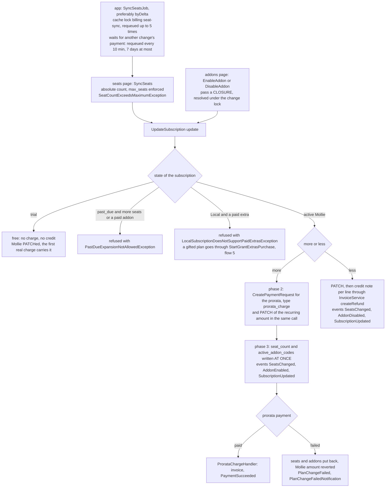

- **A seat or addon change is applied before its charge clears**, a plan change after —
  that is the one difference from flow 8, and why the failure path has to take it back.
- **Addons priced per seat** have two lines, `addon` and `addon_seats`. Switching the addon
  moves both; a seat change moves only the difference in *charged* addon seats
  (`SubscriptionAmount::addonChargedSeats()`). The plan's seat count is read from the plan's
  own `seats` line only.
- **A recurring coupon** entered with the change is redeemed in phase 3, but its marker is
  built in phase 1 (`CouponService::recurringMarkerFor()`) and travels on the
  `PlanChangeIntent`: every PATCH of the change — the executor's and phase 2c's — is priced
  from it, so the first amount Mollie is sent is already the discounted one. Nothing of the
  coupon is written before the change itself: a phase 3 that rolls back (the campaign filled
  up in the meantime) leaves no redemption, and Mollie, which already holds the discount, is
  re-priced from the committed state (`PlanWaiver::syncMollieOrQueue()`). A PATCH that
  failed is queued as before; the retry reads the marker as written. Only then — the PATCH
  did not reach Mollie — is Mollie re-priced once more after the commit.
- **A relative change is never wrapped in a transaction.** `AddonNotAllowedException` and
  `SeatDowngradeRequiredException` come from `ValidateSubscriptionChange`.
- **On a cancelled subscription** an added seat or paid addon is refused
  (`SubscriptionEndedChangeNotAllowedException`); one given back is credited at the unused
  paid share, the end date stays, and `MollieSubscriptionPatcher::updateForIntent()` sends
  nothing to the cancelled Mollie subscription.
- **The seat and addon screens show the amount collected or credited now** before the
  change is confirmed, from `PreviewService::previewUpdate()`.

---

## 10. Scheduled change

**Trigger:** `UpdateSubscription::update()` resolving to `end_of_period` →
`ScheduleSubscriptionChange::schedule()`. **Applied by:** the renewal itself, or the nightly
pass 5 → `ApplyScheduledChangesJob`. **Admin:** the scheduled-changes list.

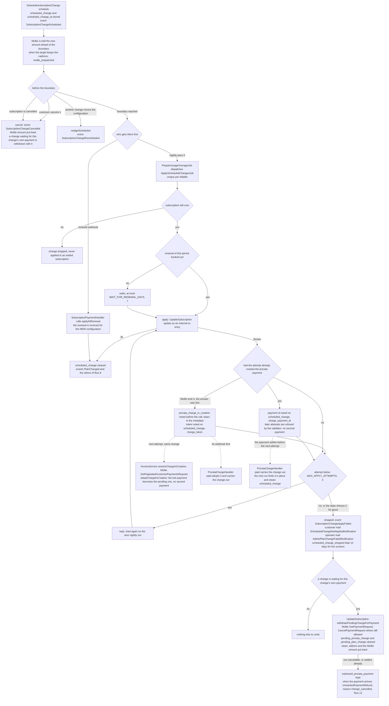

- A renewal that was created at Mollie *before* the change could reach it settles at the old
  amount: `SupersededRenewalRefund` returns the surplus, `UndercollectionCharge` collects a
  shortfall ([6](#6-renewal)).
- Applied on request ("apply now" in the portal) a failure is shown on the screen and the
  change stays booked — attempts are only counted for the unattended run. A payment that
  attempt created is noted on the change all the same.
- **A failure after the prorata payment exists** (`update()` threw once
  `InvoiceService::createCharge()` had returned — an app listener on `PlanChangePending`, a
  failed write) leaves the payment in flight. No later attempt creates a second one: the
  validator refuses a change while another waits for its payment. If the stored change is then
  given up — attempts used up, refused, cancelled by the customer or the operator — the change
  waiting for *that* payment goes with it (`UpdateSubscription::withdrawPendingChangeForPayment()`),
  so a payment that settles later is returned in full ([13](#13-refunds-and-the-refunds-the-package-makes-on-its-own))
  instead of carrying out a change the customer was told is off. A waiting change that names a
  different payment — an immediate seat change made in the meantime — is not touched.
- **A payment whose creation went unanswered** (Mollie took it, the answer was lost) is found
  again by the token written into `prorata_charge_in_creation` before the call: adopted by the
  next attempt for the same change or by its own webhook, cancelled or returned for a different
  one, withdrawn with a dropped change. The daily `CleanupStalePendingProrataChangeJob` drops a
  note nobody took over within 48 hours and retries the cancel of a payment Mollie could not be
  asked about (`lookup_failed`). See plan-changes.md, "A payment whose creation went unanswered".
- **While past due** `ScheduleSubscriptionChange::schedule()` refuses an expansion
  (`PastDueExpansionNotAllowedException`) and, under a pure overage debt, every plan or
  interval change; a reduction is stored and the plan screen says the open payment remains
  due. `ScheduleSubscriptionChange::apply()` gives the same answer on the night: an expansion
  is dropped at once, a reduction applied.
- **What became of a scheduled change is shown**: `ScheduleSubscriptionChange::retryState()`
  ("attempt n of 3") and `ScheduleSubscriptionChange::droppedNotice()` feed the dashboard,
  the plan screen and the operator's list; `UndercollectionCharge::cases()` feeds the
  balance-charge notices and the operator's table.

---

## 11. Usage and overage

**Trigger:** the app calls `HasBilling::recordBillingUsage()` → `WalletUsageService::debit()`.
Collection: `PrepareUsageOverageJob` (nightly, or `billing:prepare-overage` →
`PrepareOverageCommand`) → `ChargeUsageOverageDirectly` → webhook `SingleChargeHandler`
(metadata `type = overage`).

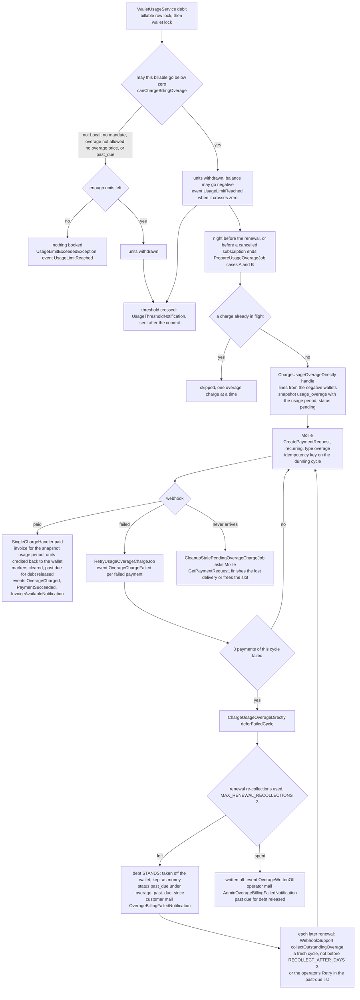

- **The sweep only creates the payment.** Wallet reset and period anchor belong to the
  renewal ([6](#6-renewal)); the renewal also charges whatever the sweep missed, and its
  reset preserves a debt that is still owed.
- **The invoice states the period the usage was in**, not the billable's period when the payment
  settles: every snapshot line carries its usage period from its first charge on, so a SEPA
  payment that settles after the renewal, a retry created in the next period and a standing debt
  collected later together with new overage are each invoiced line by line for the period they
  charge. The payment's metadata carries the lines without periods (1024-byte cap); the webhook
  takes them from the snapshot. A payment from before the upgrade is dated by Mollie's
  `createdAt`.
- **A create-payment call that never came back** leaves a snapshot without a payment id
  (`payment_unknown_at`). It is not retried blindly beyond Mollie's one-hour idempotency
  window; the cleanup job looks the payment up
  (`GetPaginatedCustomerPaymentsRequest`) and adopts it or frees the slot.
- **The whole pass fails three times:** `AdminOverageSweepFailedNotification`.
- **Local subscriptions** are hard-capped and never charged; the one exception is a debt a
  downgrade to the free plan left behind with a recorded price, collected at the Local
  period boundary if the mandate survived.
- **Plan change with usage:** `WalletPlanChangeAdjuster` rebalances; what it cannot resolve
  is charged by `ChargeUsageOverageDirectly::handleExplicit()` after the commit.
- **Immediate cancellation** charges the open overage at once ([15](#15-cancellation-resubscribe-expiry)).
- `UsageOverageChargeResult` / `UsageOverageChargeOutcome` say which of "nothing owed",
  "payment created", "failed" happened.

---

## 12. One-time orders

**Trigger:** products page, `HasBilling::purchaseOneTimeOrder()` →
`StartOneTimeOrderCheckout`. **Webhook:** `OneTimeOrderHandler` (metadata
`type = one_time_order`).

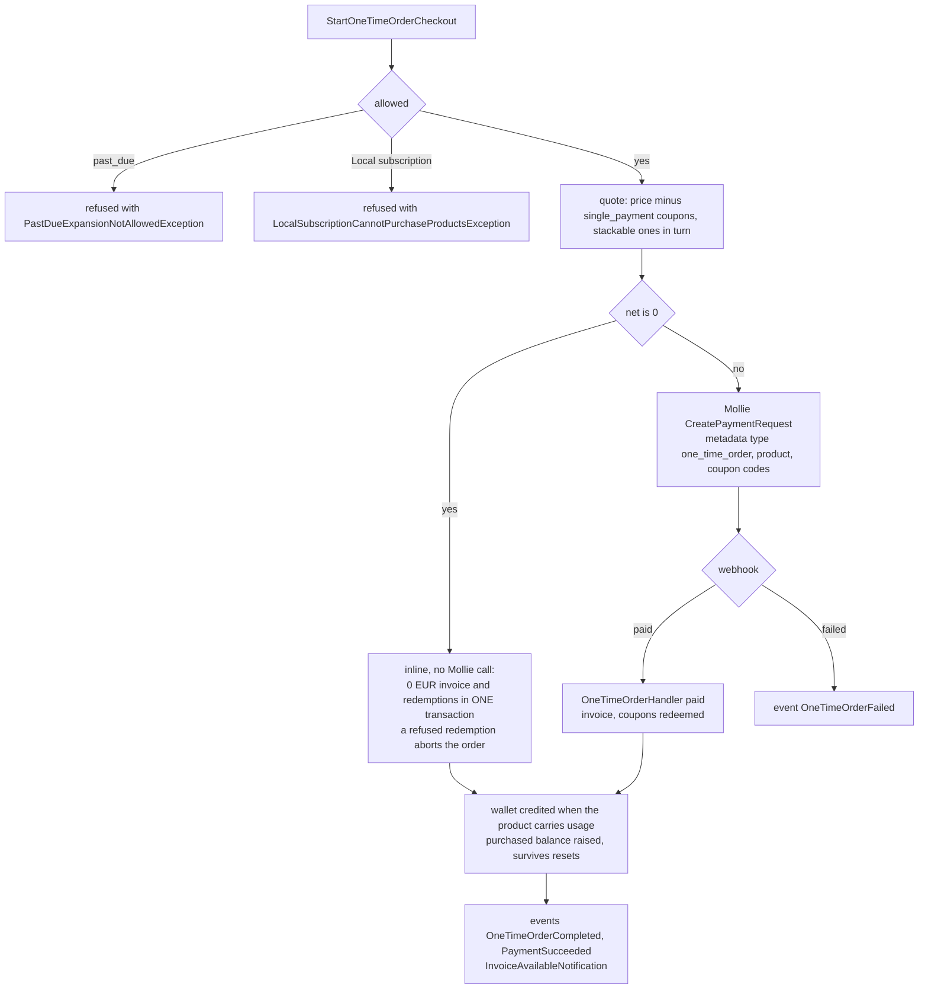

Refunds made in the Mollie dashboard for such a payment are synced like any other
([13](#13-refunds-and-the-refunds-the-package-makes-on-its-own)).

---

## 13. Refunds, and the refunds the package makes on its own

**Trigger (manual):** admin refunds list / invoices tab → `RefundInvoiceService`
(`MollieBilling::refunds()`). **Trigger (sync):** a refund created in the Mollie dashboard →
webhook → `RefundHandler`.

```mermaid
sequenceDiagram
    autonumber
    participant A as Admin panel
    participant R as RefundInvoiceService
    participant DB as Database
    participant M as Mollie
    participant I as InvoiceService

    A->>R: refundFully, refundPartially, refundLine, refundOverageUnits
    Note over R: cache lock billing invoice-refund, loser gets RefundInProgressException
    R->>DB: phase 1 decide, row lock, remaining refundable amount
    Note over R: InvalidRefundTargetException, RefundExceedsInvoiceAmountException, RefundExceedsLineAmountException
    R->>M: phase 2, CreatePaymentRefundRequest with idempotency key invoice-refund
    alt Mollie refuses
        R-->>A: nothing booked, operator mail AdminRefundFailedNotification
    else accepted
        R->>DB: phase 3 write, row lock
        R->>I: createCreditNote with deferDocument, refunded_net raised
        R->>DB: wallet units handed back when requested
        R->>I: PDF rendered and stored after the commit
        R-->>A: events CreditNoteIssued, InvoiceRefunded, WalletCredited
        R-->>A: customer mail RefundProcessedNotification
    end
```

- **By line** (`RefundInvoiceService::refundLine()`, the line select in the admin refund
  modal): the credit note carries one line for that invoice line
  (`InvoiceService::creditLineFor()`), at its rate and within what is left of it
  (`InvoiceService::refundableLines()`); more is refused with
  `RefundExceedsLineAmountException`. Money only — an overage line's units are handed back
  by `refundOverageUnits`. An amount refund is spread over the lines by what is left of
  each, so a line refunded before takes no share of a later one.
- **Webhook sync** (`RefundHandler`): deduplicated by Mollie refund id; a refund Mollie
  later reports as `failed` or `canceled` is taken out again with a reversal document —
  `RefundReversed`, operator mail `AdminRefundFailedNotification`.
- **Refund lines of a plan change** go through `InvoiceService::createRefund()`; a refused
  line is parked under `pending_refund_retries` and posted again by `RetryRefundLineJob`
  (1 min, 5 min, 30 min, 2 h, then every 2 h; 7 days at most, then dead-lettered with an
  operator mail). One job per line, one at a time per billable.
- A regenerated document dispatches `InvoicePdfRegenerated`.

### Automatic refunds

Every payment the package receives becomes an invoice, and a payment nobody wants becomes
that invoice's credit note — never a refund without a trace.

```mermaid
flowchart TD
    A["a payment settles for something that is gone"] --> B{"which case"}
    B -->|"prorata charge of a change the customer cancelled<br/>or of a scheduled change that was dropped"| C["UnwantedPaymentRefund, reason change_cancelled"]
    B -->|"prorata charge, subscription has ended since"| D["UnwantedPaymentRefund, reason subscription_ended"]
    B -->|"renewal for a cancelled or expired subscription"| E["UnwantedPaymentRefund, reason renewal_after_end<br/>plus Mollie CancelSubscriptionRequest"]
    B -->|"first payment whose activation failed for good"| F["UnwantedPaymentRefund, reason activation_failed"]
    B -->|"extras on a gift that has ended"| G["GrantExtrasPurchaseRefund"]
    B -->|"renewal created for an older, dearer configuration"| H["SupersededRenewalRefund<br/>surplus only, through RefundInvoiceService"]
    B -->|"paid payment whose billable does not exist"| I["MollieWebhookController reportPaidWithoutBillable<br/>trace row, operator mail AdminPaidWithoutBillableNotification, once"]
    C --> J["invoice for the payment, one line flagged payment_not_applied"]
    D --> J
    E --> J
    F --> J
    J --> K["InvoiceService createRefund<br/>Mollie CreatePaymentRefundRequest, credit note"]
    K --> L["event UnwantedPaymentRefunded<br/>customer mail UnwantedPaymentRefundedNotification, once per payment"]
    K -.->|"Mollie refuses"| M["pending_refund_retries, RetryRefundLineJob<br/>operators told only in this case"]
    I --> N["RefundUnassignedPaymentsJob, daily"]
    N --> O{"after 14 days"}
    O -->|"billable has turned up"| P["booked through the ordinary webhook path"]
    O -->|"still nobody"| Q["Mollie CreatePaymentRefundRequest in full<br/>no invoice and no credit note: there is no addressee<br/>operator told after 3 further days of failed attempts"]
```

The invoice and credit note of an `UnwantedPaymentRefund` carry the VAT rate **the payment
was charged at**. For a billable without a billing country (it was removed after the
charge) the rate is read off the last document the billable was charged with
(`UnwantedPaymentRefund::rateThePaymentWasChargedAt()`, asked before
`ensureBillingCountry()` fills in the fallback country) — the money was exact before, but a payment priced at 20 % was documented
at the fallback country's 19 %.

---

## 14. Activation retry

**Trigger:** an activation that did not finish — `CreateSubscriptionRequest` failed, the
process died between invoice and subscription, or the state refused it.
`WebhookSupport::scheduleActivationRetry()` → `RetrySubscriptionActivationJob`.

```mermaid
flowchart TD
    A["activation did not finish<br/>FirstPaymentHandler, MandateOnlyPaymentHandler, LocalToMollieUpgradeHandler"] --> B["WebhookSupport: marker activation_retries per payment<br/>event SubscriptionActivationFailed, once"]
    B --> C["RetrySubscriptionActivationJob, first run after 60 s<br/>unique per payment"]
    C --> D{"activation complete meanwhile"}
    D -->|"yes"| E["marker cleared"]
    D -->|"no"| F["Mollie GetPaymentRequest"]
    F --> G{"still paid"}
    G -->|"no"| E
    G -->|"yes"| H["replay through MollieWebhookController replayDelivery<br/>with ActivationRetry resuming: the gate is re-claimed, the existing invoice reused"]
    H --> I["before creating: GetPaginatedSubscriptionsRequest<br/>a subscription the first attempt created is adopted, not duplicated"]
    I --> J{"complete now"}
    J -->|"yes"| E
    J -->|"no"| K{"attempts left<br/>ladder 1 min, 5 min, 15 min, 1 h, 6 h"}
    K -->|"yes"| C
    K -->|"no"| L{"did the payment collect money"}
    L -->|"yes"| M["UnwantedPaymentRefund, reason activation_failed<br/>invoice, credit note, customer mail"]
    L -->|"no, mandate only"| N["nothing to return"]
    M --> O["operator mail AdminPlanChangeFailedNotification<br/>the first and only time an operator hears of it"]
    N --> O
```

A lost job (flushed queue, dead worker) is restarted by `SweepPendingRetriesJob`, which reads
the marker once it is older than the ladder. On the `sync` driver the sweep is the ladder: it
runs the job hourly from the start, and a sync run that does not finish keeps the marker
until the ladder's time is over.

---

## 15. Cancellation, resubscribe, expiry

**Trigger:** dashboard or admin panel → `CancelSubscription`; dashboard →
`ResubscribeSubscription`; nightly `PrepareUsageOverageJob`.

```mermaid
flowchart TD
    A["CancelSubscription handle"] --> B{"status new or expired"}
    B -->|"yes"| C["InvalidSubscriptionStateException"]
    B -->|"no"| D["scheduled change dropped: SubscriptionChangeCancelled<br/>pending plan change cancelled through UpdateSubscription"]
    D --> E{"source"}
    E -->|"local"| F["status cancelled<br/>ends_at = now when immediate, else the end date it had,<br/>30 days from now if it had none, the trial end during a trial"]
    E -->|"mollie"| G["Mollie CancelSubscriptionRequest, 404 and 410 count as done"]
    G -->|"fails"| H["pending_subscription_cancel stored<br/>operator mail AdminPlanChangeFailedNotification<br/>SweepPendingRetriesJob then RetrySubscriptionCancelJob, 24 h at most"]
    G --> I["status cancelled<br/>ends_at = now when immediate, else the next billing date,<br/>the trial end during a trial"]
    H --> I
    I -->|"immediately"| J["ChargeUsageOverageDirectly: open overage charged now"]
    F --> K["event SubscriptionCancelled<br/>customer mail SubscriptionCancelledNotification"]
    I --> K
    J --> K
    K --> L{"before ends_at"}
    L -->|"customer resubscribes"| M["ResubscribeSubscription"]
    M --> N{"source"}
    N -->|"local"| O["status active or trial, earlier end date restored"]
    N -->|"mollie"| P["CreateSubscription: a NEW Mollie subscription<br/>CreateSubscriptionRequest, start at the paid period's end or the trial end<br/>running coupon marker honoured"]
    O --> Q["event SubscriptionResumed<br/>no wallet credit, the period's units are still there"]
    P --> Q
    L -->|"ends_at passes"| R["PrepareUsageOverageJob pass 1<br/>status expired, source none, plan, interval, addons wiped<br/>event SubscriptionExpired"]
    R --> S["RequireActiveSubscription sends the user to checkout<br/>a new checkout starts again at flow 1 or 2"]
```

- A cancelled Mollie subscription whose period ends tomorrow gets its last overage charge
  from the nightly pass ([11](#11-usage-and-overage)).
- `ResubscribeSubscription` refuses while a country mismatch is open
  (`InvalidSubscriptionStateException`).
- The mandate is left alive on purpose; it is revoked only when replaced or when an
  orphaned checkout is cleaned up.
- A renewal Mollie still collects after the end is returned automatically
  ([13](#13-refunds-and-the-refunds-the-package-makes-on-its-own)).

---

## 16. Chargeback

**Trigger:** the customer's bank pulls a settled payment back. Mollie re-calls the webhook
for the same payment; the status stays `paid`, only the charged-back total changes — which
is why the webhook's outcome signature carries it. **Handler:** `ChargebackHandler`.

```mermaid
flowchart TD
    A["webhook: payment with chargebacks"] --> B["ChargebackHandler handle<br/>deduplicated by Mollie chargeback id"]
    B --> C{"chargeback already reversed when first seen"}
    C -->|"yes"| D["not booked"]
    C -->|"no"| E["credit note against the original invoice<br/>net resolved from the invoice's own lines<br/>events CreditNoteIssued, InvoiceRefunded"]
    E --> F{"status active, trial or past_due"}
    F -->|"yes"| G["status past_due, payment_failure names the chargeback<br/>past_due_since set once, a running clock is not restarted<br/>event PaymentFailed, operator mail"]
    F -->|"no, cancelled or expired"| I["booked only, status untouched"]
    G --> J["the ordinary dunning of flow 7 owns what follows<br/>the Mollie subscription is NOT cancelled here"]
    E --> K{"later: Mollie reports reversedAt"}
    K -->|"yes"| L["reversal document through InvoiceService reverseBookedCredit<br/>event ChargebackReversed, operator mail"]
    L --> M{"is this chargeback what the billable is past due for"}
    M -->|"yes"| N["status back to active via statusAfterRecovery"]
    M -->|"no, a renewal failed since"| O["status left alone"]
```

---

## 17. Webhook intake

**Trigger:** every Mollie payment webhook → `MollieWebhookController`. Mollie does not sign
these webhooks; integrity comes from fetching the payment (`GetPaymentRequest`) and from
the processed-webhook table.

```mermaid
flowchart TD
    A["POST webhook, id of the payment"] --> B{"reserve: pending row for this payment"}
    B -->|"another delivery in flight"| C["503, Mollie re-delivers<br/>a reservation older than RESERVATION_TTL_MINUTES, 15, is taken over"]
    B -->|"reserved"| D["Mollie GetPaymentRequest"]
    D -->|"PaymentNotFoundException"| E["200, reservation released"]
    D -->|"Mollie unreachable"| F["503, reservation released"]
    D --> G{"outcome signature<br/>terminal status, refunded total, charged-back total"}
    G -->|"open, pending, authorized"| H["200, nothing recorded<br/>the later terminal delivery still books"]
    G -->|"this outcome already processed<br/>and no refund or chargeback on the books"| I["200, skipped"]
    G -->|"new outcome"| J{"billable resolvable from the metadata"}
    J -->|"no, and paid"| K["reportPaidWithoutBillable, flow 13"]
    J -->|"yes"| L{"route by status and metadata"}
    L -->|"paid, type mandate_only"| M1["MandateOnlyPaymentHandler"]
    L -->|"paid, type one_time_order"| M2["OneTimeOrderHandler"]
    L -->|"paid, type prorata_charge"| M3["ProrataChargeHandler"]
    L -->|"paid, type country_correction"| M4["CountryCorrectionHandler"]
    L -->|"paid, type overage or a legacy mid-cycle type"| M5["SingleChargeHandler"]
    L -->|"paid, has subscriptionId"| M6["SubscriptionPaymentHandler"]
    L -->|"paid, upgrade_from_local"| M7["LocalToMollieUpgradeHandler"]
    L -->|"paid, anything else"| M8["FirstPaymentHandler"]
    L -->|"failed, canceled, expired"| M9["the same handler's failed side<br/>an aborted checkout payment never makes a billable past due"]
    M2 --> N["then RefundHandler and ChargebackHandler<br/>sync refunds and chargebacks on the same payment"]
    M3 --> N
    M4 --> N
    M5 --> N
    M6 --> N
    M7 --> N
    M8 --> N
    N --> O["reservation becomes the processed row with the signature<br/>200"]
    M1 --> O
    L -.->|"ActivationClaimHeldException"| P["503, reservation released"]
    L -.->|"any other exception"| Q["500, reservation released, Mollie re-delivers"]
```

- **Idempotency has two layers:** the reservation plus outcome signature above, and the
  invoice guard (`WebhookSupport::invoiceAlreadyExistsForPayment()`) at the top of every
  handler that writes an invoice — a re-delivery after a crash must not trip the unique
  index on `mollie_payment_id`.
- **Activation is gated** by `ActivationGate` (`ActivationGate::Proceed`, `ActivationGate::AlreadyBooked`,
  `ActivationGate::Duplicate`) and
  the activation claim ([1](#1-checkout-of-a-paid-plan)).
- `PruneProcessedWebhooksJob` deletes processed rows older than 180 days.
- `billing:webhook-replay` (`WebhookReplayCommand`) and the jobs that poll Mollie replay a
  payment through `MollieWebhookController::replayDelivery()`.

---

## 18. VAT and OSS

**Trigger:** every price calculation (`VatCalculationService`), the billing-data form (VIES),
every booked payment (`CountryMatchService::check()`), the admin OSS page.

```mermaid
flowchart TD
    A["VatCalculationService calculate<br/>country, net, billable"] --> B{"country invoiceable"}
    B -->|"no"| C["NonEuCountryException<br/>checkout refuses before any payment"]
    B -->|"yes"| D{"VAT number on file and VIES-valid,<br/>customer country differs from the seller's"}
    D -->|"yes"| E["reverse charge, rate 0"]
    D -->|"no"| F["rate of the customer's country"]
    G["billing-data form: VAT number entered"] --> H["validateAndPersist, VIES lookup"]
    H -->|"VIES down"| I["ViesUnavailableException, form blocks"]
    H -->|"valid"| J["validation row stored, reverse charge applies"]
    K["after every booked payment:<br/>CountryMatchService check"] --> L{"B2B with VAT number"}
    L -->|"yes"| M["skipped"]
    L -->|"no"| N{"user country matches the payment country<br/>or the IP country"}
    N -->|"yes"| M
    N -->|"no"| O["flag: mismatch row, invoices linked<br/>CancelSubscription at period end<br/>event CountryMismatchFlagged<br/>customer mail CountryMismatchSelfNotification"]
    O --> P["booking pages redirect to the dashboard<br/>RequireResolvedCountryMismatch"]
    P --> Q["customer or operator picks the country: resolve"]
    Q --> R["each linked invoice refunded through RefundInvoiceService<br/>billing country corrected, event CountryMismatchResolved"]
    R --> S["InvoiceService issueCorrectionCharge<br/>Mollie CreatePaymentRequest, recurring, type country_correction"]
    S --> T{"webhook"}
    T -->|"paid"| U["CountryCorrectionHandler paid<br/>reissued invoice at the right rate, original period kept<br/>event PaymentSucceeded"]
    T -->|"failed"| V["CountryCorrectionHandler failed<br/>mismatch back to pending, cancelled again at period end<br/>customer mail CountryMismatchReissueFailedNotification"]
    T -->|"never arrives"| W["CleanupStalePendingCountryCorrectionJob, hourly<br/>asks Mollie, GetPaymentRequest"]
    U --> X["no automatic resume: the customer clicks Reactivate, flow 15"]
```

- **The rate comes from the country lookup, never from the gross.** A paid amount that
  differs from net plus VAT is booked as paid and reported with `PaymentAmountMismatch`.
- **OSS:** `OssProtocolService::export()` builds the yearly CSV from the invoices and credit
  notes; it is started from the admin OSS page (`GenerateOssExportJob`) or
  `billing:oss-export` (`OssExportCommand`) and downloaded through
  `OssExportDownloadController`. Credit notes carry the original period, so a refund and its
  reissue net out in the right quarter.
- A visitor from a blocked country is shown `BlockedCountryController`'s page.

### 18.1 Invoice document and e-invoice

**Trigger:** every booked invoice and credit note (`InvoiceService::createForPayment()`,
`createInvoice()`, `createCreditNote()` and the other writers, after `persistWithSerial()`),
`InvoiceService::regeneratePdf()`, and `InvoiceDownloadController` when the stored PDF is
missing.

```mermaid
flowchart TD
    A["InvoiceService generateAndStorePdf<br/>locale pinned per invoice"] --> B["buildPdfInvoice<br/>readable PDF via DOMPDF,<br/>exemption note from EInvoiceService taxExemptionNote"]
    B --> C{"invoices.e_invoice.enabled"}
    C -->|"no"| G["plain PDF stored on invoices.disk"]
    C -->|"yes"| D["InvoiceService attachEInvoice<br/>EInvoiceService embedIntoPdf"]
    D --> E["EN 16931 CII from the stored invoice:<br/>profile en16931 ZUGFeRD or xrechnung,<br/>380 invoice or 381 credit note,<br/>VAT category S, AE, O or E"]
    E --> F["PDF/A-3 with factur-x.xml attached"]
    F --> H["hybrid PDF stored on invoices.disk"]
    D -->|"throws: missing seller data, library error"| I["error logged,<br/>plain PDF stored instead"]
    I --> G
```

- **Built from the stored invoice, not from the billable's current state** — the VAT
  category comes from the invoice's own rates, country and VIES validation. Only the buyer's
  name and address are read from the billable, as for the readable PDF.
- **No Mollie call, no transaction:** the document is rendered after the invoice row is
  committed (`deferDocument` for credit notes inside a refund).
- The structured part is what makes the PDF an e-invoice under § 14 UStG; see
  `docs/e-invoicing.md`.

---

## 19. Scheduled jobs

Registered in `MollieBillingServiceProvider::registerScheduledJobs()`; all times UTC.

| Job | Schedule | What it does |
|---|---|---|
| `PrepareUsageOverageJob` | daily, `overage_job_time` (02:00) | Pass 1: expire subscriptions whose `subscription_ends_at` passed (`SubscriptionExpired`). Pass 2: per billable — overage charge the night before a renewal or an end; period turnover for Local subscriptions and deferred charges; end the deferral of a deactivated 100 % coupon. Pass 3: `RetryUsageOverageChargeJob` for charges that never reached Mollie. Pass 4: auto-cancel after `past_due_max_days`. Pass 5: `ApplyScheduledChangesJob` for due changes. |
| `ProcessTrialLifecycleJob` | daily, `trial_lifecycle_job_time` (02:05) | `TrialEndingSoonNotification`; lapsed trials → `past_due` (`TrialExpired`, `TrialExpiredNotification`); a trial whose first charge a discount defers past its end → `active` (`TrialConverted`, period from the trial end, full quota). |
| `PruneProcessedWebhooksJob` | monthly, 1st, 03:00 | Deletes webhook rows older than 180 days. |
| `PruneBillingAuditJob` | monthly, 1st, 03:30 — only when `audit.retention_days` is set | Deletes the package's own audit rows past retention. |
| `CleanupStalePendingProrataChangeJob` | daily, 03:45 | Resolves a plan-change charge whose webhook never arrived (after 24 h, hard limit 7 days); retries the cancel of a withdrawn change's payment Mollie could not be asked about (`lookup_failed`); drops a `prorata_charge_in_creation` note nobody took over within 48 h, cancelling its payment where possible. |
| `RefundUnassignedPaymentsJob` | daily, 04:15 | Refunds paid payments without a billable after 14 days. |
| `CleanupStalePendingOverageChargeJob` | daily, 04:15 | Resolves an overage charge whose webhook never arrived, or whose creation call never came back. |
| `CleanupStalePendingCountryCorrectionJob` | hourly | Resolves a country-correction charge whose webhook never arrived. |
| `SweepPendingRetriesJob` | hourly | Queues `RetrySubscriptionReplacementJob`, `RetrySubscriptionPatchJob`, `RetrySubscriptionCancelJob`, `RetryRefundLineJob` and `RetrySubscriptionActivationJob` for every marker without a running chain. |
| `CleanupOrphanedBillablesJob` | `cleanup.cron_expression` (every 15 min), when `cleanup.enabled` | Removes billables of abandoned checkouts (`CheckoutAbandoned`), revokes their mandate (`RevokeMollieMandateJob`). Also `billing:cleanup-orphans` (`CleanupOrphanedBillablesCommand`). |

Queued on demand, not scheduled:

| Job | Queued by | What it does |
|---|---|---|
| `ApplyScheduledChangesJob` | `PrepareUsageOverageJob` pass 5 | Applies one billable's due change ([10](#10-scheduled-change)). |
| `RetryUsageOverageChargeJob` | `SingleChargeHandler` on a failed overage payment; pass 3 | Next payment of a dunning cycle ([11](#11-usage-and-overage)). |
| `RetrySubscriptionActivationJob` | `WebhookSupport`; the sweep | Runs an unfinished activation again ([14](#14-activation-retry)). |
| `RetrySubscriptionPatchJob` | `UpdateSubscription`, `ProrataExecutor`, `ProrataChargeHandler`, `ScheduleSubscriptionChange`; the sweep | Repeats a failed PATCH of the recurring amount; 24 h at most. |
| `RetrySubscriptionCancelJob` | `MollieSubscriptionPatcher`; the sweep | Repeats a failed cancel at Mollie; 24 h at most. A 404, 410 or 422 "has been cancelled" is success. |
| `RetrySubscriptionReplacementJob` | `MollieSubscriptionReplacer`; the sweep | Finishes a replacement of a charged subscription ([6.1](#61-moving-the-next-charge-patch-or-replacement)): cancel if not confirmed, create or adopt the successor. Never gives up; one operator mail after 24 h. |
| `RetryRefundLineJob` | the sweep | Posts a parked refund line again; 7 days at most. |
| `RevokeMollieMandateJob` | `RevokePreviousMandate`, `CleanupOrphanedBillablesJob`, `GrantExtrasPurchaseRefund` | Revokes a mandate at Mollie. |
| `SyncSeatsJob` | the host app; itself, put back | Seat change under a lock ([9](#9-seats-and-addons)); put back when the lock is busy (5×, 1 min) or another change waits for its payment (every 10 min, 7 days). |
| `GenerateOssExportJob` | admin OSS page | Builds the OSS CSV ([18](#18-vat-and-oss)). |

**On the `sync` queue driver** a job runs inside the request that dispatched it and one that
throws has failed for good (`BillingQueue::isSyncRun()`). The retry jobs therefore do not
throw on a sync run: `RetryRefundLineJob`, `RetrySubscriptionPatchJob` and
`RetrySubscriptionCancelJob` keep their marker — with the first failure's time, so the window
still counts from there — and `SweepPendingRetriesJob` is their ladder, hourly, until the
window ends with the one operator mail. `RetryUsageOverageChargeJob` leaves the charge
`pending` for pass 3 of the next night and lets the third failed night reach `failed()` (the
operator mail). The activation retry is not dispatched from the webhook on `sync` at all;
the sweep runs it hourly from the start and it keeps its marker until the ladder's time is
over ([14](#14-activation-retry)). `billing:check-config` warns about a sync connection.

---

## 20. Entry points and supporting classes

Controllers — none of them books anything itself:

| Controller | Role |
|---|---|
| `MollieWebhookController` | the webhook ([17](#17-webhook-intake)) |
| `BillingPortalController` | renders the portal pages: checkout, dashboard, plan, seats, addons, products, usage, invoices, billing data, return. The Livewire components on them call the services above. |
| `BillingAdminController` | renders the admin panel shell |
| `PromotionController` | auto-apply coupon link → session → checkout |
| `InvoiceDownloadController` | serves an invoice or credit-note PDF from the configured disk |
| `OssExportDownloadController` | serves a generated OSS export |
| `BlockedCountryController` | the page a blocked country is shown |

Supporting classes that appear in several flows:

| Class | Role |
|---|---|
| `InvoiceService` | every invoice, credit note, plan-switch invoice, prorata charge and refund line; `MollieSalesInvoiceService` is its deprecated alias |
| `InvoiceNumberGenerator` | gap-free serial numbers per invoice kind |
| `EInvoiceService` | the EN 16931 e-invoice (ZUGFeRD / XRechnung CII) embedded in every invoice PDF ([18.1](#181-invoice-document-and-e-invoice)) |
| `WebhookSupport` | what the webhook handlers share: gate, claim, reconciliation, quota credit, activation reporting |
| `FirstPaymentArtifacts` / `FirstPaymentCouponPricing` | book and price a first payment |
| `MollieSubscriptionPatcher` | every PATCH and cancel of a Mollie subscription for future periods |
| `MollieSubscriptionGate` / `MollieSubscriptionSnapshot` | what Mollie currently says about the subscription (cached 60 s) |
| `MollieMandateInspector` | reads the mandate for display |
| `NextChargeSummary` | what the next charge will be, for the dashboard |
| `PreviewService` | prices a change without applying it |
| `ValidateSubscriptionChange` | every rule a change must pass |
| `ProrataComposer` / `ProrataExecutor` | compute and carry out the prorata of a change |
| `PlanChangeIntent`, `SubscriptionChangeContext`, `SubscriptionUpdateRequest` | the data a change travels in |
| `WalletUsageService` / `WalletPlanChangeAdjuster` | wallet debit, credit, reset; rebalance on a plan change |
